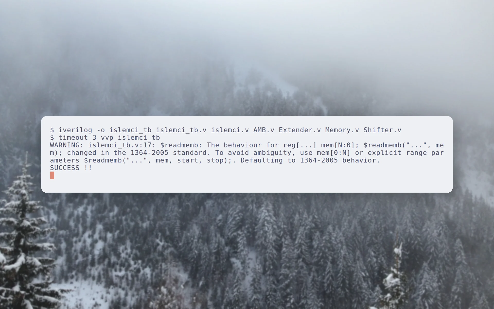
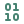

<p align="center">
  <picture>
    <source media="(prefers-color-scheme: dark)" srcset="docs/brand/svg/16-bit-processor-logo-on-dark.svg">
    
  </picture>
</p>

<h1 align="center">A 16-bit CPU in Verilog. One instruction per cycle.</h1>

<p align="center">
  Coursework from 2019: a 16-bit processor with a self-checking testbench.<br>
  <b>16 registers. 8 opcodes. Simulated with Icarus Verilog.</b>
</p>

<p align="center">
  
  
  
  
  <a href="https://github.com/mertkayacs/16-Bit-Processor"></a>
</p>

<p align="center">
  <a href="#quick-start"></a>
  <a href="islemci.v"></a>
  <a href="islemci_tb.v"></a>
</p>

<p align="center">
  <picture>
    <source media="(prefers-color-scheme: dark)" srcset="docs/assets/readme/hero-dark.webp">
    
  </picture>
</p>

16-Bit Processor is a processor written in Verilog for a university course in 2019. It runs one instruction per clock cycle and has 16 general-purpose registers, a special function register, a unified 64 KB instruction and data memory, and an eight-opcode instruction set. A testbench loads a program from Mem.mem, runs it and checks the result.

---

## Why 16-Bit Processor

The design is small enough to read in one sitting.

|  |  |
|---|---|
|  **One instruction per cycle** | Fetch, decode and execute happen in a single clock cycle, as the repository description states. |
|  **Small instruction set** | Eight opcodes, with 9-bit and 13-bit immediates extended to 16 bits by [Extender.v](Extender.v). |
|  **Five modules** | The processor, the ALU, the extender, the unified memory and the shifter each have their own file. |
|  **A testbench that checks itself** | The testbench runs the program in Mem.mem and prints SUCCESS when register 6 holds 0x004c. |

## Features

**Processor**

- 16 general-purpose registers and a special function register, SFR_A.
- Byte-addressed unified memory for instructions and data, 16-bit addresses.
- ALU with add, subtract and equality, and a shifter that shifts left or right by the amount in SFR_A.

**Test**

- Program image in Mem.mem, one byte per line, loaded with $readmemb.
- Testbench reports SUCCESS or a failure message.

## Quick start

```sh
iverilog -o islemci_tb islemci_tb.v islemci.v AMB.v Extender.v Memory.v Shifter.v
vvp islemci_tb
```

The run prints a `$readmemb` warning from the simulator and then `SUCCESS !!`. The testbench has no `$finish`, so stop the simulation with Ctrl+C after the result prints.

### Requirements

- Icarus Verilog (iverilog and vvp).

## Modules

| File | Role |
|---|---|
| `islemci.v` | The processor: fetch, decode and execute. |
| `AMB.v` | Arithmetic logic unit: add, subtract, equality. |
| `Extender.v` | Sign or zero extension of 9-bit and 13-bit immediates. |
| `Memory.v` | Unified byte-addressed memory. |
| `Shifter.v` | Shift left or right by SFR_A. |
| `Mem.mem` | Program image in binary, one byte per line. |

## FAQ

<details>
<summary><b>Which simulator do I need?</b></summary>

Icarus Verilog. The two commands above compile and run the testbench.
</details>

<details>
<summary><b>How do I know it works?</b></summary>

The testbench prints SUCCESS when register 6 holds 0x004c after the program in Mem.mem finishes.
</details>

<details>
<summary><b>Why does the simulation not stop?</b></summary>

The clock in the testbench runs forever and there is no $finish. Press Ctrl+C after the result.
</details>

<details>
<summary><b>Why are the names Turkish?</b></summary>

The course was taught in Turkish. islemci means processor, and the opcode names in islemci.v are Turkish abbreviations.
</details>

If 16-Bit Processor is useful to you, a ⭐ helps other people find it.

Photos behind the screenshots are credited in [docs/assets/readme/CREDITS.md](docs/assets/readme/CREDITS.md).

[](https://github.com/mertkayacs/16-Bit-Processor)
